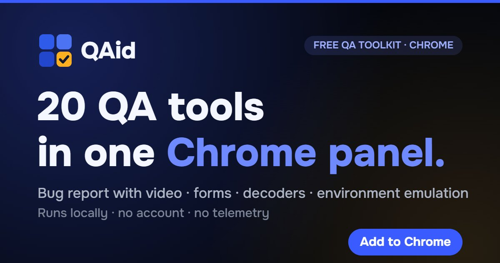

# QAid — a free QA toolkit for Chrome

**QAid is a free Chrome extension that puts 20 manual-testing tools into a single side panel.**
It opens over any tab, so a tester can file a bug, fake test data, decode a token or
override the environment without leaving the page or digging through DevTools.

  <a href="https://chromewebstore.google.com/detail/bgpenkpfmoeomlippkndllojhjiciedd?utm_source=github"><b>▸ Add to Chrome</b></a>
  &nbsp;·&nbsp;
  <a href="https://qaid-app.github.io/">Website</a>

- **Free, forever.** No paid plans, no subscription, no trial, no limits — all 20 tools work the moment you install.
- **No account.** No sign-up, no login, nothing to connect.
- **Private by design.** Everything runs locally in your browser; the extension makes no network requests and uses no cloud, analytics or trackers.
- **One panel, any tab.** The side panel stays open over the page you're testing.

## What's inside

### Report & inspect
- **Bug report** — a ready ticket with video, steps, console, network and environment, all in one artifact.
- **Screen recording** — screen capture with audio, clicks and console.
- **Screenshot** — the visible area or the full page, with annotations.
- **Element inspector** — properties, styles and a stable selector for automated tests.
- **Defect scan** — finds missing `alt`, broken images, empty buttons and links.
- **Compare states** — two versions of a page side by side, before and after.

### Layout & design checks
- **Contrast check** — WCAG text contrast, right on the page.
- **Ruler** — sizes and spacing in pixels between elements.
- **Page colors** — the page palette and an eyedropper for any color.
- **Page fonts** — font families, sizes and weights.
- **On-page overrides** — edit text and styles on the fly for a clean screenshot.

### Environment & session
- **Environment emulation** — override language, timezone, geolocation and device (User-Agent).
- **Cookies & storage** — view and edit cookies, `localStorage` and `sessionStorage`.
- **Login profiles** — saved sessions and roles; sign in with one click.
- **Request mocking** — mock and intercept network responses for a single tab.

### Decoders & test data
- **Decoders** — JWT, Base64, URL and JSON, decoded on your own machine.
- **Form autofill & audit** — fill forms with valid, boundary, empty or injection data, then audit the fields.
- **Time, hashes, UUID** — timestamps, MD5 / SHA and a UUID generator.
- **Random numbers** — numbers in a given range for test data.
- **Random strings** — strings, passwords and emails to fill forms.

## Privacy

QAid collects nothing. All tools run locally in your browser — not a single network
request leaves your machine. No accounts, no telemetry, no cloud, no trackers. You can
verify it yourself in the Network tab of DevTools.

## Supported browsers

Google Chrome and Chromium-based browsers — Microsoft Edge, Brave, Opera, Vivaldi, Arc
and Yandex Browser.

## Install

1. Open QAid in the [Chrome Web Store](https://chromewebstore.google.com/detail/bgpenkpfmoeomlippkndllojhjiciedd?utm_source=github).
2. Click **Add to Chrome**.
3. Open the side panel over any tab — no sign-up, no setup.

---

Made for testers. [qaid-app.github.io](https://qaid-app.github.io/)
